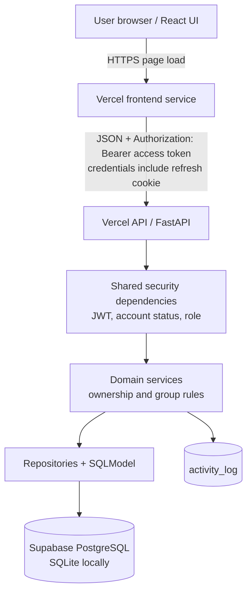
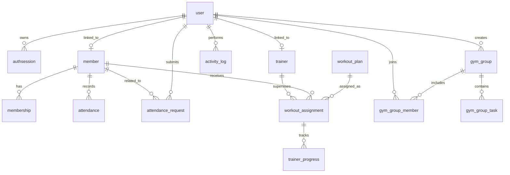
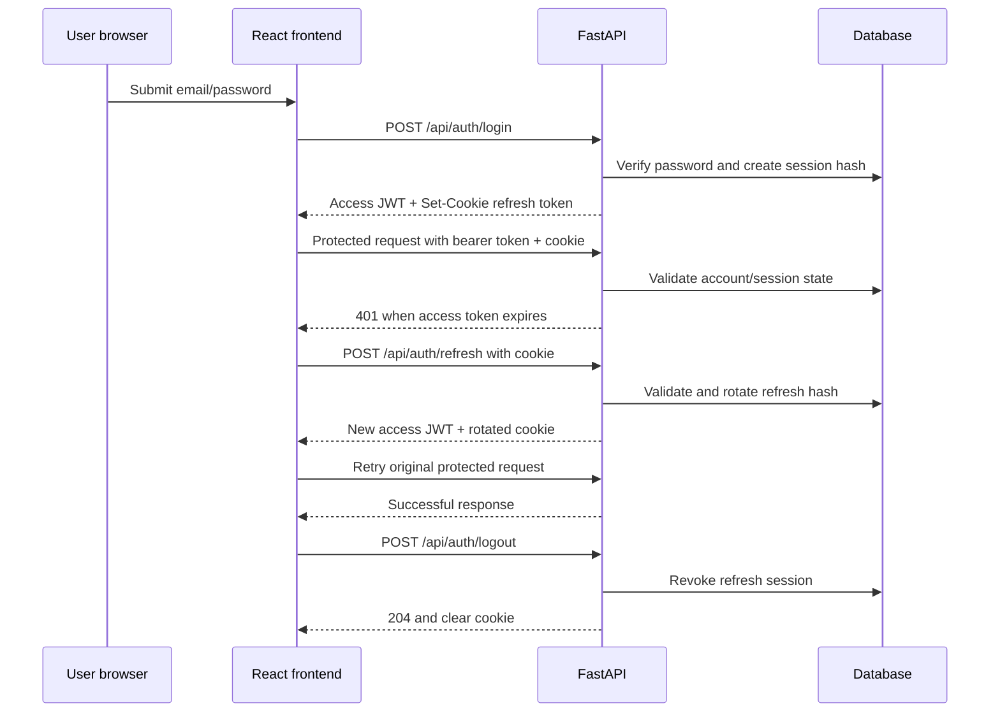
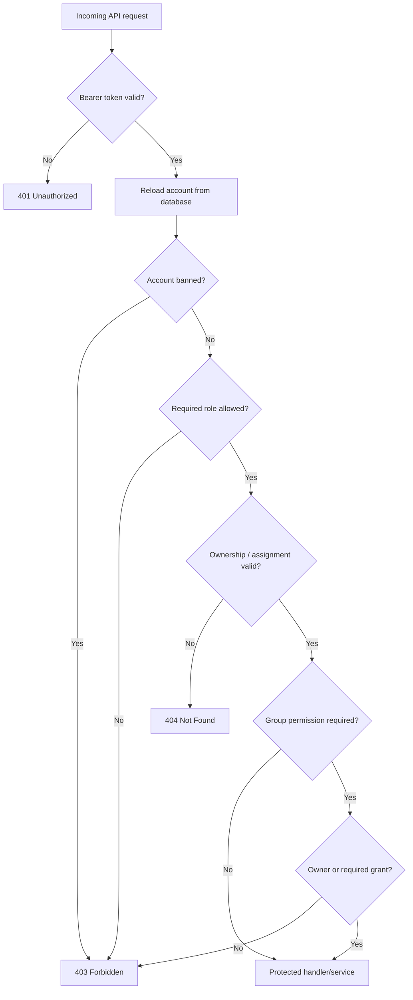
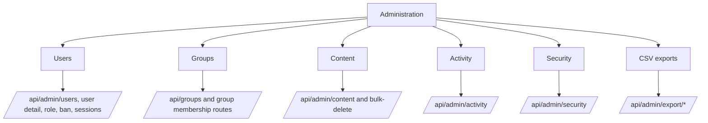
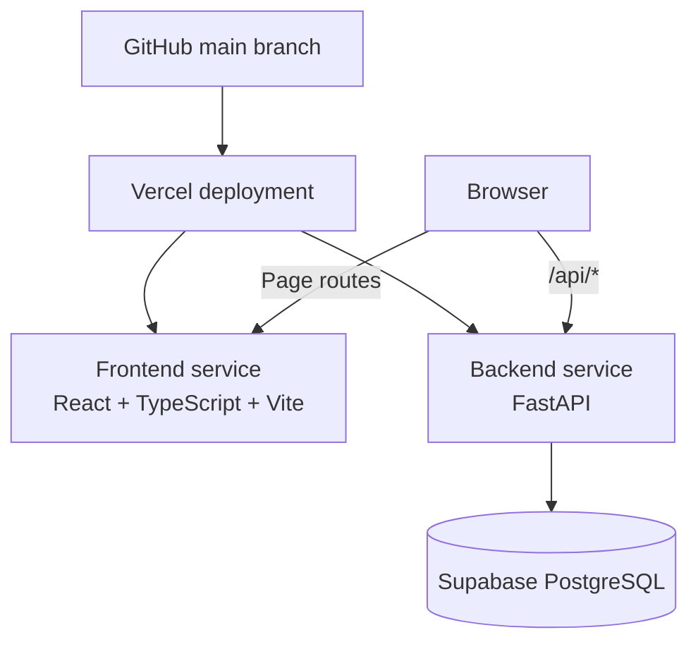

Independent University, Bangladesh  
CSE309 Web Application & Internet

# Final Project Submission Report

**Submitted by:**  
Name: Syed Miftahul Islam  
Student ID: 2430996  
Section: 6  
Team Number: 35

Project Title: GymTrack - Gym Management Web Application  
Vercel URL: https://gymtrack-nemesis-team.vercel.app/  
GitHub Repository: https://github.com/IraqX2/GymTrack

**Submitted To:**  
Sayef Reyadh  
Adjunct Lecturer  
Department of Computer Science & Engineering  
Independent University, Bangladesh

Semester: Autumn 2026  
Date of Submission: 28/11/2026

## Table of Contents

1. [Executive Summary](#1-executive-summary)
2. [Part A. Product Requirements (PRD)](#part-a-product-requirements-prd)
3. [Part B. Software Requirements (SRS)](#part-b-software-requirements-srs)
4. [Part C. Technical Design (TDD)](#part-c-technical-design-tdd)
5. [Part D. Evidence: Screenshots of the Running Application](#part-d-evidence-screenshots-of-the-running-application)
6. [Part E. Project Management and Conclusion](#part-e-project-management-and-conclusion)
7. [Appendix. Test Accounts and Video Demo](#appendix-test-accounts-and-video-demo)

## List of Figures and Screenshots

**Figures**

1. GymTrack actors and supported use cases (PDF, p. 11)
2. GymTrack production architecture (PDF, p. 14)
3. GymTrack logical entity relationships (PDF, p. 16)
4. JWT login, expiry, refresh and logout sequence (PDF, p. 18)
5. Backend authorization flow (PDF, p. 20)
6. Admin dashboard features and API routes (PDF, p. 21)
7. Vercel deployment and request routing (PDF, p. 23)

**Screenshots from the deployed application**

| Screenshot | Evidence | PDF page |
|---|---|---:|
| S1 | Signup/login page with validation error | 24 |
| S2 | Signed-in member page showing the member's own records | 24 |
| S3 | Profile and rejected wrong-current-password attempt | 25 |
| S4 | Active sessions and revoke controls | 25 |
| S5 | Group members and create/edit/assign permissions | 26 |
| S6 | Admin-only action denied with HTTP 403 | 26 |
| S7 | Expired access-token request in Network panel | 27 |
| S8 | Refresh request in Network panel | 27 |
| S9 | Banned account rejected on a protected request | 28 |
| S10 | Administrator overview statistics | 28 |
| S11 | User list with role/status filters and pagination | 29 |
| S12 | User detail, sessions and recent activity | 29 |
| S13 | Banned account state | 30 |
| S14 | Content moderation list and selected bulk action | 30 |
| S15 | Activity log with demonstration events | 31 |
| S16 | Security view by IP address and account | 31 |
| S17 | CSV export opened in a spreadsheet | 32 |
| S18 | Vercel production deployment | 32 |
| S19 | Vercel project environment settings | 33 |
| S20 | Live API documentation | 33 |
| S21 | Successful GitHub Actions test run | 34 |

The screenshots are included in the private PDF submission. This public Markdown file does not embed screenshots or private demo credentials.

## 1. Executive Summary

### 1.1 Project overview

GymTrack is a web-based gym management application that centralizes member records and daily training operations. Members use a personal portal to review their own memberships, attendance and assigned workouts. Trainers access only the trainees and assignments linked to their trainer profile and can record workout completion progress. Administrators manage user accounts, member and trainer records, memberships, attendance, workout plans, assignments and shared groups; they can also review activity/security information and export supported records. Group members collaborate through shared tasks with backend-enforced create, edit and assign permissions.

**Technology stack:** React 19, TypeScript 5.9 and Vite 6.3; Python 3.10+ and FastAPI; SQLModel; SQLite for local development; Supabase PostgreSQL in production; Argon2 password hashing through pwdlib; HS256 JWT access tokens through PyJWT; Vercel hosting.

### 1.2 What was built since the mid assessment

- JWT authentication with signup, login, 15-minute access tokens, seven-day rotating HttpOnly refresh sessions, logout, profile/password management and session revocation.
- Role-based access control for user, trainer and admin roles, including member ownership checks, trainer assignment ownership and group create/edit/assign permissions.
- An administrator-managed Trainer workspace, including promotion of a normal account, assigned trainee/workout views and progress history.
- An Admin dashboard for statistics, user search/filter/pagination, user details, role changes, ban/unban, bulk actions, supported content moderation, activity/security summaries and CSV exports.
- Gym workflows for members, trainers, memberships, attendance, attendance correction requests, workout plans and assignments, plus shared groups.
- A layered backend structure with domain routers/controllers, services and repositories, shared authentication dependencies, SQLModel models and request schemas.
- Vercel deployment backed by persistent Supabase PostgreSQL, with GitHub Actions running backend tests and the frontend production build.

### 1.3 Live links

| Item | Link / status |
|---|---|
| GitHub repository | https://github.com/IraqX2/GymTrack |
| Vercel frontend | https://gymtrack-nemesis-team.vercel.app/ |
| API base | https://gymtrack-nemesis-team.vercel.app/api |
| API documentation | https://gymtrack-nemesis-team.vercel.app/api/docs |
| Google Drive demo video | [Watch recording](https://drive.google.com/file/d/1kgGaEt0FDfeYkm_6RSHR-Z-B_DixB9Nf/view?usp=sharing) |
| YouTube demo video | [Watch recording](https://www.youtube.com/watch?v=EJdNnCJ_gNw) |

## Part A. Product Requirements (PRD)

### A1. Problem Statement

Gyms maintain several types of operational information: member profiles, membership periods, attendance, trainer assignments and workout plans. When this information is held in paper records or separate spreadsheets, staff may need to update the same information in several places, and it can be difficult to identify the latest or correct record. Members may also have limited visibility into their own membership and training information.

Different gym users require different levels of access. Members should see their own records, trainers should work only with their assigned trainees, and administrators need broader management capabilities. Without clearly enforced ownership and role restrictions, a user may be able to view or change records outside their responsibility. Shared team work introduces another access-control problem: a group member may need permission to create, edit or assign tasks without being allowed to administer the entire group.

### A2. Users and Roles

**Table 2. Users and roles**

| Role | Who they are | Main tasks | Must never be able to |
|---|---|---|---|
| Visitor | Not signed in | Open public pages; sign up; log in | Read private member, trainer or admin data |
| User/member | Registered member account | View own profile, memberships, attendance and workouts; submit attendance requests; use granted group actions | Read another member's private records; call trainer/admin-only actions; promote own role |
| Trainer | User account promoted by an admin and linked to a trainer profile | View own assigned trainees/workouts; record progress for own assignments | Manage accounts or global gym records; access another trainer's assignments; use admin actions |
| Group owner | Owner membership for one group | Add/remove members, grant permissions, rename/delete group and use all group task actions | Access unrelated records merely because of group ownership |
| Group member | Member of one group | View group work; create/edit/assign only within granted rules | Change permissions, remove other members, rename/delete group or bypass missing permissions |
| Admin | Administrator account | Manage accounts, gym records, trainers, activity/security and exports | Change own role or ban self/another admin through protected admin actions |

Group owner/member are group-membership roles, not separate application login roles. The application login roles are `user`, `trainer` and `admin`.

### A3. Goals and Success Measures

**Table 3. Goals and measures**

| ID | Goal | Success measure |
|---|---|---|
| G-01 | Secure account access | Public signup creates a user role; valid login succeeds and invalid credentials are rejected. |
| G-02 | Protect sessions | Access token lifetime is 15 minutes; refresh session lifetime is seven days; refresh rotates the stored token hash; logout/revocation prevents reuse. |
| G-03 | Protect member privacy | A member can access their own records; another member's private record is denied or returned as not found. |
| G-04 | Enforce trainer ownership | Trainer dashboard and progress operations are restricted to assignments linked to the signed-in trainer. |
| G-05 | Enforce group permissions | Backend checks create/edit/assign flags; an ungranted restricted operation returns 403. |
| G-06 | Provide accountable administration | Admin operations are protected and implemented important actions are written to the activity log; supported CSV downloads work. |
| G-07 | Preserve production data | Deployed records use Supabase PostgreSQL rather than temporary Vercel filesystem storage. |

### A4. Scope and Non-Goals

**In scope**

- Signup, login, profile and password updates, logout and session management.
- JWT access authentication, rotating refresh sessions and backend role checks.
- Member, trainer, membership, attendance, workout plan and assignment management.
- Trainer promotion, trainer dashboard, assignment ownership and progress history.
- Shared groups with owner-controlled membership and create/edit/assign permissions.
- Admin user management, role changes, ban/unban, session revocation, supported moderation, audit/security views and CSV exports.
- Vercel deployment with Supabase PostgreSQL persistence.

**Out of scope**

- Online payment processing and automatic subscription billing.
- Biometric access control or gym hardware integration.
- Nutrition/meal planning, native mobile apps and real-time chat.
- Multi-branch operations and branch-level administration.

**Assumptions and constraints**

- The system is accessed through a modern browser with JavaScript enabled.
- Vercel serves the frontend and API; the production API requires a configured PostgreSQL connection.
- The frontend communicates with FastAPI and does not connect directly to PostgreSQL.
- Production secrets are stored as Vercel server-side environment variables, not in source control.
- The project was developed within the CSE309 Autumn 2026 course timeline.

### A5. User Stories

**Table 4. User stories**

| ID | Role | User story |
|---|---|---|
| US-01 | Visitor | As a visitor, I want to register so that I can use GymTrack as a member. |
| US-02 | Visitor | As a visitor, I want to log in so that I can access my account. |
| US-03 | Member | As a member, I want to view my membership and attendance so that I can monitor my gym activity. |
| US-04 | Member | As a member, I want to see my assigned workouts so that I can follow my training plan. |
| US-05 | Member | As a member, I want to submit an attendance correction request so that staff can review an incorrect record. |
| US-06 | Trainer | As a trainer, I want to see only my assigned trainees so that I can focus on my work. |
| US-07 | Trainer | As a trainer, I want to record completion percentage and notes so that progress is tracked. |
| US-08 | Admin | As an admin, I want to promote a user to trainer so that the account can access the trainer workspace. |
| US-09 | Admin | As an admin, I want to search and filter accounts so that I can manage users efficiently. |
| US-10 | Admin | As an admin, I want to ban or unban an eligible user so that access can be controlled. |
| US-11 | Admin | As an admin, I want to review activity and security events so that important actions are auditable. |
| US-12 | Admin | As an admin, I want to export supported records as CSV so that I can use the data outside the app. |
| US-13 | Group owner | As a group owner, I want to manage membership and permissions so that group responsibilities can be divided. |
| US-14 | Group member | As a group member, I want to create, edit or assign tasks only when allowed so that group work stays controlled. |

## Part B. Software Requirements (SRS)

### B1. Introduction

**Purpose and intended readers**

This specification defines the observable behaviour of GymTrack and the requirements used to design and verify it. It is intended for the course instructor, project team, developers and testers reviewing the source code or deployed application.

**Definitions**

| Term | Definition |
|---|---|
| JWT | JSON Web Token: a signed token containing account claims. |
| Access token | Short-lived JWT sent in the Authorization bearer header for protected requests. |
| Refresh token | Random longer-lived credential stored in an HttpOnly cookie; the server stores only its hash and rotates it. |
| RBAC | Role-Based Access Control: authorization based on the account role. |
| Role | Application access category: `user`, `trainer` or `admin`. |
| Permission | A specific allowed group operation: `can_create`, `can_edit` or `can_assign`. |
| Ownership check | Backend verification that a resource or assignment belongs to the signed-in member/trainer. |
| Audit log | Stored record of an important action, actor, target and request metadata. |
| Argon2 | Password-hashing algorithm used through pwdlib. |

**Technical references**

| Reference | Use |
|---|---|
| [FastAPI](https://fastapi.tiangolo.com/) | Routing, dependencies, request validation and HTTP responses. |
| [SQLModel](https://sqlmodel.tiangolo.com/) | SQLModel tables, typed fields and database sessions. |
| [PyJWT](https://pyjwt.readthedocs.io/) | HS256 token signing and verification. |
| [pwdlib](https://frankie567.github.io/pwdlib/) | Password hashing and Argon2 integration. |
| [Vercel documentation](https://vercel.com/docs) | Deployment configuration and routing. |
| [Supabase documentation](https://supabase.com/docs) | Hosted PostgreSQL and database configuration. |

### B2. Functional Requirements

The following IDs are used consistently in the design, test and evidence sections.

**Table 5. Authentication requirements (FR-AUTH)**

| ID | Requirement |
|---|---|
| FR-AUTH-01 | The system shall allow a visitor to register using the required signup fields. |
| FR-AUTH-02 | The system shall authenticate a registered account using its email and password. |
| FR-AUTH-03 | The system shall hash passwords using Argon2 through pwdlib and a server-side pepper. |
| FR-AUTH-04 | The system shall issue an HS256 access JWT with `sub`, `role`, `iat` and `exp` claims. |
| FR-AUTH-05 | The system shall set the access-token lifetime to 15 minutes. |
| FR-AUTH-06 | The system shall store only a hash of the refresh token and send the raw value through an HttpOnly cookie. |
| FR-AUTH-07 | The system shall rotate the refresh token when a valid refresh request is processed. |
| FR-AUTH-08 | The system shall revoke the active refresh session on logout. |
| FR-AUTH-09 | The system shall allow users to list and revoke their own sessions. |
| FR-AUTH-10 | The system shall allow a signed-in user to update their profile and change their password after current-password verification. |
| FR-AUTH-11 | The system shall lock an account for 15 minutes after five consecutive failed password attempts. |
| FR-AUTH-12 | The system shall reject missing, invalid, expired or revoked authentication credentials with an appropriate HTTP status. |

**Table 6. RBAC and ownership requirements (FR-RBAC)**

| ID | Requirement |
|---|---|
| FR-RBAC-01 | The system shall support `user`, `trainer` and `admin` application roles. |
| FR-RBAC-02 | The system shall assign the user role to public signups; signup shall not allow self-selection of trainer or admin. |
| FR-RBAC-03 | The system shall enforce administrator-only operations through a reusable backend dependency. |
| FR-RBAC-04 | The system shall reject a banned account on the next protected request. |
| FR-RBAC-05 | The system shall restrict a member's private membership, attendance, request and workout data to that member. |
| FR-RBAC-06 | The system shall restrict trainer dashboard and progress operations to assignments linked to the signed-in trainer profile. |
| FR-RBAC-07 | The system shall allow only a group owner to rename/delete the group and manage its membership/permission grants. |
| FR-RBAC-08 | The system shall enforce group create, edit and assign permissions on the backend. |
| FR-RBAC-09 | The system shall prevent a group member from changing owner permissions or removing the owner. |
| FR-RBAC-10 | The system shall prevent an administrator from changing their own role or banning self/another administrator. |

**Table 7. Administration requirements (FR-ADM)**

| ID | Requirement |
|---|---|
| FR-ADM-01 | The system shall display administration summary statistics to an authenticated admin. |
| FR-ADM-02 | The system shall provide a searchable, filterable user list with pagination. |
| FR-ADM-03 | The system shall display selected account details, sessions and recent activity. |
| FR-ADM-04 | The system shall allow an admin to change an eligible user's role. |
| FR-ADM-05 | The system shall allow an admin to ban/unban eligible accounts; a ban may include a reason. |
| FR-ADM-06 | The system shall support bulk ban and bulk unban actions for eligible accounts. |
| FR-ADM-07 | The system shall allow an admin to revoke sessions belonging to a selected account. |
| FR-ADM-08 | The system shall provide searchable, paginated moderation for supported record categories. |
| FR-ADM-09 | The system shall record implemented administrative actions in the activity log. |
| FR-ADM-10 | The system shall provide activity-log search and pagination through the API. |
| FR-ADM-11 | The system shall summarize failed login activity by IP address and account over the previous 24 hours. |
| FR-ADM-12 | The system shall provide CSV exports for supported management datasets. |
| FR-ADM-13 | The system shall return the count and identifiers affected by supported bulk actions. |

**Table 8. Gym domain requirements (FR-DOMAIN)**

| ID | Requirement |
|---|---|
| FR-DOMAIN-01 | The system shall allow administrators to create, view, update and manage member records. |
| FR-DOMAIN-02 | The system shall allow administrators to manage trainer staff profiles. |
| FR-DOMAIN-03 | The system shall allow administrators to create and manage membership records. |
| FR-DOMAIN-04 | The system shall record member attendance check-in and check-out information. |
| FR-DOMAIN-05 | The system shall allow a member to submit an attendance correction request for review. |
| FR-DOMAIN-06 | The system shall allow administrators to create and manage workout plans. |
| FR-DOMAIN-07 | The system shall allow administrators to assign workout plans to members and optionally associate a trainer. |
| FR-DOMAIN-08 | The system shall allow a trainer to record completion percentage and notes for an assignment linked to that trainer. |
| FR-DOMAIN-09 | The system shall allow authenticated users to view groups in which they are members. |
| FR-DOMAIN-10 | The system shall allow group members to create, edit and assign group tasks according to the stored permissions. |

### B3. Non-Functional Requirements

**Table 9. Non-functional requirements**

| ID | Category | Requirement / measurable check |
|---|---|---|
| NFR-SEC-01 | Security | Passwords are stored as Argon2 hashes, not plaintext. |
| NFR-SEC-02 | Security | Access JWT expires after 15 minutes. |
| NFR-SEC-03 | Security | Refresh credentials are stored as hashes and transported in an HttpOnly cookie. |
| NFR-SEC-04 | Security | Five consecutive failed password attempts cause a 15-minute account lockout. |
| NFR-SEC-05 | Security | Authorization and ownership checks are performed by the backend. |
| NFR-SEC-06 | Security | Production secrets are configured server-side and are not committed to source control. |
| NFR-PERF-01 | Performance | List endpoints use bounded pagination (users 1–100; moderation 1–100; activity 1–200). |
| NFR-USE-01 | Usability | Primary screens provide loading, empty and error states. |
| NFR-USE-02 | Usability | The React interface is intended for common desktop and mobile browser widths. |
| NFR-REL-01 | Reliability | Production records use hosted PostgreSQL, not temporary Vercel filesystem storage. |
| NFR-REL-02 | Reliability | Persistence across redeployments is verified against the hosted database. |
| NFR-MAINT-01 | Maintainability | Domain routers, services, repositories and shared security dependencies are separated. |
| NFR-MAINT-02 | Maintainability | GitHub Actions runs backend tests and a TypeScript/Vite production build. |

### B4. Roles and Permission Matrix

Application role and group membership permissions are separate. An administrator has administration capabilities but does not automatically become the owner of every group.

**Table 10. Endpoint groups against roles**

| Endpoint / action | Visitor | User | Trainer | Group member | Group owner | Admin |
|---|---|---|---|---|---|---|
| Signup/login | Yes | Yes | Yes | Yes | Yes | Yes |
| Read own profile | No | Own | Own | Own | Own | Own |
| Read own member records | No | Own | Own | Own | Own | Manage |
| Trainer dashboard/progress | No | No | Own assignments | No | No | No |
| Member/trainer CRUD | No | No | No | No | No | Yes |
| Membership/attendance/workout administration | No | No | No | No | No | Yes |
| Shared group view | No | If member | If member | Yes | Yes | If member |
| Group task create/edit/assign | No | By grant | By grant | By grant | All | By membership/grant |
| Change group membership/permissions | No | No | No | No | Yes | Only if group owner |
| Admin activity/security and exports | No | No | No | No | No | Yes |

**Table 11. Group permissions**

| Action | Group owner | Member with grant | Member without grant |
|---|---|---|---|
| View group and group work | Yes | Yes | Yes, if member |
| Create task | Yes | `can_create = true` | 403 denied |
| Edit own task | Yes | Creator may edit own task | Creator may edit own task |
| Edit another member's task | Yes | `can_edit = true` | 403 denied |
| Assign/change assignee | Yes | `can_assign = true` | 403 denied |
| Add/remove other members | Yes | No | No |
| Change member permissions | Yes | No | No |
| Rename/delete group | Yes | No | No |
| Remove self | Owner cannot leave without deleting group | Yes, except owner | Yes, except owner |

**Table 12. Admin rules**

| Rule | Implemented behaviour |
|---|---|
| Change own role | Rejected with HTTP 400: `You cannot change your own role`. |
| Ban self | Rejected with HTTP 400. |
| Ban another administrator | Rejected with HTTP 400. |
| Bulk ban containing an admin or actor | Rejected with HTTP 400. |
| Promote user to trainer | Allowed for an eligible account; trainer profile is created/reactivated and linked. |
| Admin inside a group | Admin role does not automatically grant group ownership; group operations still check group membership. |
| Trainer role | Does not grant account-management or global gym-management permissions. |

### B5. Use Cases

**UC-01. Sign in and refresh an expired access token**

- Actor: Registered user, trainer or admin.
- Preconditions: Account exists, is not banned and has a valid refresh session.
- Main flow:
  1. Submit credentials to `POST /api/auth/login`.
  2. API verifies the Argon2 hash.
  3. API returns an access token and sets the refresh cookie.
  4. Frontend sends the bearer token for protected requests.
  5. An expired access token receives HTTP 401.
  6. Frontend calls `POST /api/auth/refresh` with the cookie.
  7. Backend rotates the refresh hash and returns a new access token.
  8. Frontend retries the original request once.
- Alternative/error flows: Invalid credentials 401; locked account 429; banned account 403; missing/expired/revoked refresh session 401.
- Postcondition: Renewed access token if refresh succeeds.

**UC-02. Create a group task**

- Actor: Group owner or group member with create permission.
- Preconditions: Signed in and a member of the target group.
- Main flow: Open group work; enter a title and optional assignee; submit `POST /api/groups/{group_id}/work`; service loads group membership; service checks `can_create` and, if an assignee is supplied, `can_assign`; service verifies the assignee belongs to the group and stores the task.
- Alternative/error flows: Not a group member 404; missing create/assign permission 403; assignee outside group 422.
- Postcondition: Group task is saved.

**UC-03. Change a member's group permissions**

- Actor: Group owner.
- Preconditions: Signed in and owner of the group.
- Main flow: Open group member list; select a member; set `can_create`, `can_edit` and `can_assign`; submit `PATCH /api/groups/{group_id}/members/{target_id}`; service verifies owner role and updates the grant flags.
- Alternative/error flows: Non-owner 403; missing group/member 404; changing owner permissions 400.
- Postcondition: Updated permission values are stored.

**UC-04. Attempt an action denied by RBAC**

- Actor: Normal user/member.
- Preconditions: Signed in with user role.
- Main flow: Send `GET /api/admin/stats`; backend validates bearer token; current-user dependency loads the account and checks ban status; ADMIN dependency checks the role; API returns 403 and no admin data.
- Alternative/error flows: Missing/invalid token 401; banned account 403.
- Postcondition: Normal user receives no administrative statistics.

**UC-05. Ban an eligible user**

- Actor: Admin.
- Preconditions: Authenticated admin; target is an eligible non-admin account.
- Main flow: Open user list/detail; choose Ban and provide a reason; frontend posts to `/api/admin/users/{target_id}/ban`; service prevents self/admin ban, marks target banned and revokes open sessions; audit event is recorded; target's next protected request is rejected.
- Alternative/error flows: Non-admin 403; target not found 404; self/admin target 400.
- Postcondition: Account is banned and sessions are revoked.

**UC-06. Read the activity log**

- Actor: Admin.
- Preconditions: Authenticated admin.
- Main flow: Open Activity; frontend requests `GET /api/admin/activity` with optional `q`, `offset` and `limit`; ADMIN dependency verifies access; service/repository returns matching audit records; UI displays available events.
- Alternative/error flows: Non-admin 403; invalid/missing token 401.
- Postcondition: Admin can review available audit history.

**Table 13. Use-case summary**

| Use case | Main endpoint(s) | Success result |
|---|---|---|
| UC-01 Sign-in/refresh | `POST /api/auth/login`, `/refresh`, `/logout` | New access token; refresh session rotated/revoked. |
| UC-02 Create group task | `POST /api/groups/{id}/work` | Task saved after create/assign checks. |
| UC-03 Change permissions | `PATCH /api/groups/{id}/members/{user_id}` | Owner updates create/edit/assign flags. |
| UC-04 RBAC denial | `GET /api/admin/stats` | Normal user receives 403. |
| UC-05 Ban user | `POST /api/admin/users/{id}/ban` | Eligible account banned; session revoked and audited. |
| UC-06 Read audit log | `GET /api/admin/activity` | Admin receives searchable activity events. |

### B6. Acceptance Criteria

**Table 14. Acceptance criteria**

| ID | Given | When | Then |
|---|---|---|---|
| AC-01 / FR-AUTH-05 | Access token has expired | Protected request is sent | Old token is rejected with 401; frontend attempts one refresh for an eligible request. |
| AC-02 / FR-AUTH-07 | Refresh session is valid | Client calls `/api/auth/refresh` | New access token is returned and refresh cookie is rotated. |
| AC-03 / FR-AUTH-12 | Token signature is tampered | Protected request is sent | API rejects token with 401. |
| AC-04 / FR-RBAC-05 | Member is signed in | Requests another member's private record | API returns 404 for out-of-scope member record. |
| AC-05 / FR-RBAC-08 | Group member lacks create/edit/assign grant | Attempts restricted operation | API returns 403. |
| AC-06 / FR-RBAC-04 | Account is banned | Sends protected request | API returns 403. |
| AC-07 / FR-ADM-03 | Admin is signed in | Opens user detail | Supported account information, sessions and activity are returned. |
| AC-08 / FR-ADM-05 | Admin targets eligible non-admin | Confirms ban | Account becomes banned, sessions are revoked and audit events are recorded. |
| AC-09 / FR-ADM-05 | Admin targets another admin | Attempts ban | Service rejects request with 400. |
| AC-10 / FR-RBAC-06 | Trainer is signed in | Requests assignment owned by another trainer | API returns 404. |
| AC-11 / FR-DOMAIN-08 | Trainer owns assignment | Submits valid progress 0–100 | Progress entry is stored and appears in history. |

### B7. Traceability Matrix

**Table 15. Requirement traceability**

| Requirement | Implementation | Test / check | Evidence |
|---|---|---|---|
| FR-AUTH-01–02 | Signup/login forms; `/api/auth/signup` and `/login` | Backend auth tests; live credential test | S1 |
| FR-AUTH-03 | `auth_service.py` password hash/verify | Password hashing tests | S21 |
| FR-AUTH-04–05 | JWT issued by `auth_service.py` | JWT claim and expiry checks | S7 |
| FR-AUTH-06–07 | `/api/auth/refresh`; HttpOnly cookie | Refresh rotation check | S8 |
| FR-AUTH-08–09 | `/api/auth/logout`; `/api/auth/sessions` | Logout/revoke check | S4 |
| FR-AUTH-10 | Profile and password endpoints | Wrong-current-password check | S3 |
| FR-AUTH-11 | Login service lockout | Five failed attempts / 429 check | S21 |
| FR-AUTH-12 | `current_user` dependency | Missing/invalid/expired-token checks | S7, S21 |
| FR-RBAC-01–04 | `core/dependencies.py`; admin/trainer routers | Role and ban rejection checks | S6, S9 |
| FR-RBAC-05 | `member_service.py` and member dashboard | Cross-member record check | S2 |
| FR-RBAC-06 | `trainer_service.py` and trainer routes | Cross-trainer assignment check | Trainer workflow |
| FR-RBAC-07–09 | `group_service.py` and `/api/groups` | Owner and permission matrix checks | S5, S6 |
| FR-RBAC-10 | `admin_service.py` role/ban checks | Self-role/admin-ban checks | S21 |
| FR-ADM-01–03 | Admin overview/users/detail | Admin list/detail checks | S10–S12 |
| FR-ADM-04–07 | Admin role/ban/session routes | Role, ban, unban and revoke checks | S12, S13 |
| FR-ADM-08 | `/api/admin/content` | Supported category moderation check | S14 |
| FR-ADM-09–10 | `/api/admin/activity` | Audit/search check | S15 |
| FR-ADM-11 | `/api/admin/security` | Failed-login summary check | S16 |
| FR-ADM-12–13 | `/api/admin/export/*` and bulk routes | CSV and affected-count checks | S14, S17 |
| FR-DOMAIN-01–04 | Member/trainer/membership/attendance modules | CRUD and attendance workflow checks | Application workflow |
| FR-DOMAIN-05 | `/api/attendance/requests` | Create and review correction request | Application workflow |
| FR-DOMAIN-06–08 | Workout routes; trainer dashboard/progress | Assignment and progress ownership checks | Trainer workflow |
| FR-DOMAIN-09–10 | Group routes and `group_service.py` | View and create/edit/assign permissions | S5, S6 |

## Part C. Technical Design (TDD)

### C1. Technology Stack

**Table 16. Technology stack**

| Component | Technology | Version / requirement | Reason |
|---|---|---|---|
| Frontend framework | React | ^19.1.0 | Component-based user interface. |
| Frontend language | TypeScript | ^5.9.0 | Static typing for UI and API data. |
| Build tool | Vite | ^6.3.0 | Development server and production bundling. |
| Backend framework | FastAPI | >=0.115.0 | Typed API routes, dependencies and request validation. |
| Runtime | Python | 3.10+; CI uses 3.12 | Backend language/runtime. |
| ORM/data models | SQLModel | >=0.0.22 | Typed relational models and DB sessions. |
| PostgreSQL driver | psycopg[binary] | >=3.2.0 | PostgreSQL connectivity. |
| Local database | SQLite | Python standard library driver | Simple local development persistence. |
| Production database | Supabase PostgreSQL | Hosted | Persistent deployment database. |
| Password hashing | pwdlib + Argon2 | >=0.2.0 | Password hashing with a server-side pepper. |
| JWT | PyJWT | >=2.8.0 | HS256 access-token signing/verification. |
| API server | Uvicorn | >=0.30.0 | ASGI server for FastAPI. |
| Testing | pytest | >=8.0 | Backend automated tests. |
| Hosting | Vercel | `vercel.json` services/rewrites | Frontend/API deployment. |
| CI/source control | GitHub Actions | GitHub-hosted workflow | Automated backend test and frontend build checks. |

The current frontend package does not list a separate component/UI library. The interface is built with React components and project CSS.

### C2. System Architecture

The browser loads the React application from Vercel. The shared frontend API client sends JSON requests to FastAPI, attaches the access token in the Authorization header and includes browser-managed cookies. FastAPI routes pass through shared authentication/role dependencies, domain services enforce business rules and ownership, repositories perform database access through SQLModel, and supported actions write records to `activity_log`.

**Figure 2. Production request flow**



1. Browser to frontend: HTTPS loads the React application and static assets from Vercel.
2. Frontend to API: JSON requests are sent to `/api` routes with `Authorization: Bearer <access token>`; `credentials: include` allows the browser to send the refresh cookie.
3. Router to shared security dependency: the API validates the access token, reloads the user and checks banned status and required role.
4. Security dependency to service: an authenticated principal reaches the relevant domain service; invalid identity/role is rejected before protected logic.
5. Service to repository/database: business rules and ownership checks run before SQLModel queries or writes against Supabase PostgreSQL (or SQLite locally).
6. Service to activity log: supported authentication, admin and domain actions record actor, action, entity and request metadata in `activity_log`.

### C3. Backend and Frontend Structure

**Backend folder tree (two levels)**

```text
backend/
├── core/          # shared auth dependencies and audit helper
├── models/        # user, member, trainer, workout, resources, activity
├── schemas/       # validated auth, admin, member and trainer payloads
├── repositories/  # domain-specific database queries
├── services/      # auth, admin, member, trainer, group and gym rules
├── routers/       # auth, admin, member, trainer and gym API controllers
├── migrations/    # reviewed database schema changes
├── database.py    # local/production database engine and session
├── gymtrack_api.py# FastAPI setup, health checks and router registration
└── main.py        # Vercel FastAPI entry point
```

**Frontend folder tree (two levels)**

```text
frontend/
├── src/
│   ├── components/  # member list, form and details components
│   ├── pages/       # MembersPage and TrainerDashboard
│   ├── services/    # shared API client, auth and CSV helpers
│   ├── App.tsx      # application shell, navigation and role-specific views
│   └── main.tsx     # Vite/React entry point
├── package.json
└── vite.config.ts
```

Backend request handlers are grouped in routers; services implement authentication, role, ownership and operational rules; repositories perform domain database queries; models represent tables; schemas validate incoming payloads. `core/dependencies.py` exports `CURRENT`, `ADMIN` and `TRAINER` dependencies, while `core/audit.py` records supported audit events. `frontend/src/services/gymtrack.ts` attaches the bearer token, includes the refresh cookie and retries one qualifying request after refresh. `App.tsx` holds the main application shell and role-specific page composition.

There is no separate frontend authentication context or routing/guard library in `package.json`. Authentication restoration and role-based screen rendering are handled in the application shell and shared API client; backend dependencies remain the actual security boundary.

### C4. Data Model

Figure 3 in the submitted PDF shows the logical entities and foreign-key relationships. The application stores account roles and bans on the user record; refresh-session hashes and revocation metadata in `authsession`; per-group create/edit/assign grants in `gym_group_member`; and audit history in `activity_log`.

**Logical relationship overview**



**Table 17. user**  
`id` PK; `full_name`; indexed `email`; `password_hash`; `role` default `user`; `is_banned`; `failed_login_count`; nullable `locked_until`; `created_at`; `updated_at`.

**Table 18. member**  
`id` PK; indexed `full_name` (max 100); indexed `email` (max 254); `phone`; `join_date`; `is_active`; nullable `created_by` FK to `user.id`; nullable indexed `user_id` FK to `user.id`.

**Table 19. trainer**  
`id` PK; `full_name`; unique/indexed `email`; `phone`; `specialization`; `is_active`; `created_at`; nullable indexed `user_id` FK to `user.id`.

**Table 20. membership**  
`id` PK; indexed `member_id` FK to `member.id`; `plan_name`; `start_date`; `end_date`; `price`; `status`; `created_at`.

**Table 21. attendance**  
`id` PK; indexed `member_id` FK to `member.id`; `check_in`; nullable `check_out`; `notes`; nullable `recorded_by` FK to `user.id`.

**Table 22. attendance_request**  
`id` PK; indexed `user_id` FK to `user.id`; indexed `member_id` FK to `member.id`; requested check-in/out; `notes`; `status`; `reviewed_by`/`reviewed_at`; `review_note`; nullable unique `attendance_id` FK to `attendance.id`; `created_at`.

**Table 23. workout_plan and workout_assignment**  
`workout_plan`: `id` PK, `title`, `description`, `level`, `duration_weeks`, `created_by` FK to `user.id`, `created_at`.  
`workout_assignment`: `id` PK, `plan_id` FK to `workout_plan.id`, indexed `member_id` FK to `member.id`, nullable `trainer_id` FK to `trainer.id`, start/end dates, `status`, `assigned_by` FK to `user.id`, `created_at`.

**Table 24. trainer_progress**  
`id` PK; indexed `assignment_id` FK to `workout_assignment.id`; indexed `member_id` FK to `member.id`; indexed `trainer_id` FK to `trainer.id`; `completion_percent` (0–100); `notes` (max 600); indexed `progress_date`; indexed `created_at`.

**Table 25. authsession**  
`id` PK; indexed `user_id` FK to `user.id`; unique/indexed `refresh_token_hash`; `created_at`; `last_used_at`; `expires_at`; nullable `revoked_at`; nullable `ip_address` and `user_agent`.

**Table 26. groups and audit**  
`gym_group`: `id` PK, `name`, `created_by` FK to `user.id`, `created_at`.  
`gym_group_member`: composite PK (`group_id`, `user_id`), group/user FKs, `role`, `can_create`, `can_edit`, `can_assign`, `joined_at`.  
`gym_group_task`: `id` PK, `group_id` FK, `title`, `description`, `due_date`, `assigned_to`/`created_by` user FKs, `is_completed`, timestamps.  
`activity_log`: `id` PK, nullable `user_id` FK, `email`, `action`, `entity_type`/`entity_id`, `details`, IP, user agent, `created_at`.

The hosted GymTrack Supabase project contains `public.trainer_progress` with `assignment_id`, `member_id`, `trainer_id`, `completion_percent`, `notes`, `progress_date` and `created_at`; the application maps to that existing table. Table summaries reflect SQLModel definitions and do not reproduce every database-level index or migration constraint. Production grants and RLS policies must be reviewed before real member information is stored.

### C5. API Design

The API prefix is `/api`. On Vercel, Swagger documentation is available at `/api/docs`; FastAPI error responses use a JSON `detail` field, for example `{"detail":"Administrator permission required"}`.

**Table 27. API endpoint summary**

| Method | Path | Authentication / permission | Request body / query | Success / common errors |
|---|---|---|---|---|
| POST | `/api/auth/signup` | Public | `full_name`, `email`, `password` | 201; 409; 422 |
| POST | `/api/auth/login` | Public | `email`, `password` | 200; 401; 403; 429 |
| POST | `/api/auth/refresh` | Refresh cookie | Browser sends `gymtrack_refresh` | 200; 401; 403 |
| POST | `/api/auth/logout` | Refresh cookie if present | No body | 204 |
| GET | `/api/me` | CURRENT | Bearer token | 200; 401/403 |
| PATCH | `/api/me` | CURRENT | ProfilePatch | 200; 401/422 |
| POST | `/api/me/password` | CURRENT | Current and new password | 204; 401/422 |
| GET | `/api/auth/sessions` | CURRENT | Bearer token | 200; 401 |
| DELETE | `/api/auth/sessions/{session_id}` | CURRENT | Session ID | 204; 401/404 |
| GET | `/api/members` | CURRENT | `offset`, `limit` (1–100) | 200; 401 |
| POST | `/api/members` | ADMIN | MemberCreate | 201; 403/409/422 |
| GET | `/api/members/{member_id}` | CURRENT; own or admin | Member ID | 200; 401/404 |
| PUT | `/api/members/{member_id}` | ADMIN | MemberUpdate | 200; 403/404/409/422 |
| DELETE | `/api/members/{member_id}` | ADMIN | Member ID | 204; 403/404/409 |
| GET | `/api/member/dashboard` | CURRENT; member/trainer | Bearer token | 200; 403/404 |
| GET/POST/PUT/DELETE | `/api/trainers`, `/api/trainers/{trainer_id}` | ADMIN | TrainerPayload / trainer ID | 200/201/204; 403/404/409/422 |
| GET | `/api/trainer/dashboard` | TRAINER | Bearer token | 200; 403 |
| GET | `/api/trainer/assignments/{assignment_id}/progress` | TRAINER; own assignment | Assignment ID | 200; 403/404 |
| POST | `/api/trainer/assignments/{assignment_id}/progress` | TRAINER; own assignment | `completion_percent`, `notes` | 201; 403/404/422 |
| GET | `/api/memberships` | CURRENT; scoped | Bearer token | 200; 401 |
| POST/PATCH/DELETE | `/api/memberships`, `/api/memberships/{membership_id}` | ADMIN | MembershipBody / membership ID | 201/200/204; 403/404/422 |
| GET | `/api/attendance` | CURRENT; scoped | `limit` (1–200) | 200; 401 |
| POST | `/api/attendance` | ADMIN | AttendanceBody | 201; 403/422 |
| PATCH | `/api/attendance/{attendance_id}/checkout` | ADMIN | Attendance ID | 200; 403/404 |
| GET | `/api/attendance/requests` | CURRENT; scoped | Optional status | 200; 401 |
| POST | `/api/attendance/requests` | CURRENT | AttendanceRequestBody | 201; 401/422 |
| PATCH | `/api/attendance/requests/{request_id}` | ADMIN | AttendanceRequestReview | 200; 403/404/422 |
| DELETE | `/api/attendance/requests/{request_id}` | CURRENT; own or admin | Request ID | 204; 401/403/404 |
| GET | `/api/workout-plans` | CURRENT; scoped | Bearer token | 200; 401/404 |
| POST/PUT/DELETE | `/api/workout-plans`, `/api/workout-plans/{plan_id}` | ADMIN | PlanBody / plan ID | 201/200/204; 403/404/409/422 |
| GET | `/api/workout-assignments` | CURRENT; scoped | Bearer token | 200; 401/404 |
| POST/DELETE | `/api/workout-assignments`, `/api/workout-assignments/{assignment_id}` | ADMIN | AssignmentBody / assignment ID | 201/204; 403/404/409/422 |
| GET | `/api/groups` | CURRENT | Bearer token | 200; 401 |
| POST | `/api/groups` | ADMIN | GroupBody | 201; 403/422 |
| PATCH/DELETE | `/api/groups/{group_id}` | CURRENT; owner | GroupBody / group ID | 200/204; 403/404 |
| GET | `/api/groups/{group_id}/members` | CURRENT; group member | Bearer token | 200; 401/404 |
| POST | `/api/groups/{group_id}/members` | CURRENT; owner | GroupMemberBody | 201; 403/404/409 |
| PATCH/DELETE | `/api/groups/{group_id}/members/{target_id}` | CURRENT; owner or self for removal | Permissions / target ID | 200/204; 400/403/404 |
| GET | `/api/groups/{group_id}/work` | CURRENT; group member | Bearer token | 200; 401/404 |
| POST | `/api/groups/{group_id}/work` | CURRENT; `can_create` (+ `can_assign` if assigned) | GroupWorkBody | 201; 403/404/422 |
| PATCH | `/api/groups/{group_id}/work/{work_id}` | CURRENT; owner/creator/permission checks | GroupWorkPatch | 200; 403/404/422 |
| DELETE | `/api/groups/{group_id}/work/{work_id}` | CURRENT; service checks group permissions | Work ID | 204; 403/404 |
| GET | `/api/admin/stats` | ADMIN | Bearer token | 200; 403 |
| GET | `/api/admin/users` | ADMIN | `q`, `role`, `status`, `offset`, `limit` (1–100) | 200; 403 |
| GET | `/api/admin/users/{target_id}` | ADMIN | Target ID | 200; 403/404 |
| PATCH | `/api/admin/users/{target_id}/role` | ADMIN | RoleChangeBody | 200; 400/403/404/422 |
| POST | `/api/admin/users/{target_id}/ban` | ADMIN | Optional reason | 200; 400/403/404 |
| POST | `/api/admin/users/{target_id}/unban` | ADMIN | No body | 200; 403/404 |
| POST | `/api/admin/users/bulk-ban` | ADMIN | User IDs and reason | 200; 400/403/404 |
| POST | `/api/admin/users/bulk-unban` | ADMIN | User IDs | 200; 403/404 |
| POST | `/api/admin/users/{target_id}/revoke-sessions` | ADMIN | Target ID | 204; 403/404 |
| GET | `/api/admin/content` | ADMIN | `type`, `q`, `offset`, `limit` (1–100) | 200; 403/422 |
| DELETE | `/api/admin/content/{content_type}/{record_id}` | ADMIN | Category and record ID | 204; 403/404/422 |
| POST | `/api/admin/content/{content_type}/bulk-delete` | ADMIN | IDs | 200; 403/422 |
| GET | `/api/admin/activity` | ADMIN | `q`, `offset`, `limit` (1–200) | 200; 403 |
| GET | `/api/admin/security` | ADMIN | Bearer token | 200; 403 |
| GET | `/api/admin/export/users` | ADMIN | `q`, `role`, `status` | 200 CSV; 403 |
| GET | `/api/admin/export/members` | ADMIN | `q`, `status` | 200 CSV; 403 |
| GET | `/api/admin/export/activity` | ADMIN | `q` | 200 CSV; 403 |
| GET | `/api/admin/export/trainers` | ADMIN | No filters | 200 CSV; 403 |
| GET | `/api/admin/export/memberships` | ADMIN | No filters | 200 CSV; 403 |
| GET | `/api/admin/export/attendance` | ADMIN | No filters | 200 CSV; 403 |
| GET | `/api/admin/export/workouts` | ADMIN | No filters | 200 CSV; 403 |
| GET | `/api/admin/export/assignments` | ADMIN | No filters | 200 CSV; 403 |
| GET | `/api/admin/export/groups` | ADMIN | No filters | 200 CSV; 403 |

### C6. JWT Authentication Design

**Login**

1. The client submits email and password to `POST /api/auth/login`.
2. The backend verifies the password against the Argon2 hash using the server-side pepper.
3. A signed HS256 access JWT is created with `sub`, `role`, `iat` and `exp` claims.
4. A new refresh session is stored using a hash of the refresh token.
5. The `gymtrack_refresh` token is sent in an HttpOnly cookie; the access token is returned to the frontend.

**Protected request, refresh and logout**

1. The frontend adds `Authorization: Bearer <access_token>` to protected API requests and uses `credentials: include` so the browser sends the refresh cookie.
2. `current_user` verifies the token signature and expiry, reads the user ID from `sub`, reloads the account and checks whether it exists and is not banned.
3. When an eligible protected request receives 401, the frontend calls `/api/auth/refresh` once.
4. The backend hashes the cookie value, finds the active session, rotates the stored hash and returns a new access token while replacing the cookie.
5. The frontend saves the new access token and retries the original request once. If refresh fails, it clears the token and dispatches the logout event.
6. Logout revokes the refresh session and clears the cookie. A previous refresh value is no longer valid after rotation.

**Figure 4. JWT login, expiry, refresh and logout sequence**



**Table 28. Token and session properties**

| Property | Implementation |
|---|---|
| Algorithm / claims | HS256; `sub`, `role`, `iat`, `exp`. |
| Access lifetime | 15 minutes. |
| Refresh lifetime | 7 days. |
| Cookie | `gymtrack_refresh`; path `/api/auth`; HttpOnly; SameSite=Lax; Secure on Vercel. |
| Refresh persistence | SHA-256 hash in `authsession`; includes expiry, last-used and revocation metadata. |
| Browser access-token storage | `sessionStorage` plus an in-memory variable. |
| Access transport | Authorization bearer header. |
| Refresh transport | Browser-managed cookie; `credentials: include`. |
| Secrets | `JWT_SECRET_KEY` and `PASSWORD_PEPPER` on the server; `JWT_SECRET` is a code-level legacy alias. |

Security trade-off: JavaScript can read the access token in `sessionStorage`, so an XSS vulnerability could expose it. The refresh token is HttpOnly and cannot be read directly by page JavaScript. SameSite=Lax, Secure on Vercel and the `/api/auth` cookie path reduce some cookie risks, but a dedicated CSRF review and strong XSS prevention remain important.

### C7. RBAC Design

Authorization occurs in order: bearer token presence; JWT signature/expiry verification; account reload; banned-account check; application role check; member/trainer ownership check; group membership and permission check; then the protected handler/service. The reusable role dependencies are `CURRENT`, `ADMIN` and `TRAINER` from `backend/core/dependencies.py`. Group permissions are `can_create`, `can_edit` and `can_assign`, with group membership role `owner` or `member`.

**Figure 5. Backend authorization flow**



**Reusable role-check excerpt**

```python
def admin_user(user: CURRENT) -> AppUser:
    if user.role != "admin":
        raise HTTPException(
            status_code=403,
            detail="Administrator permission required",
        )
    return user

ADMIN = Annotated[AppUser, Depends(admin_user)]

def trainer_user(user: CURRENT) -> AppUser:
    if user.role != "trainer":
        raise HTTPException(status_code=403, detail="Trainer permission required")
    return user

TRAINER = Annotated[AppUser, Depends(trainer_user)]
```

The `current_user` dependency performs token/account checks and rejects banned accounts before an endpoint-specific role dependency runs. Member services restrict a member record to the signed-in account's linked `user_id`. Trainer services resolve the linked trainer profile and query assignments by trainer ID; reads and progress writes verify assignment ownership before returning or storing data. Group services load the user's `GymGroupMember` row and check owner role or the required permission flag.

Adding a new role requires coordinated changes to role validation, the admin role-change workflow, shared dependencies, affected services, frontend role types/navigation, automated tests and documentation. A new group permission requires a persisted permission field, request-schema support, service authorization, a UI control, a migration where the schema changes, and positive/negative tests.

**Special rules**

- Public signup creates a normal user; trainer promotion is performed by an administrator.
- The admin service rejects an administrator changing their own role, banning themselves or banning another administrator; bulk ban also rejects administrator targets.
- A banned account is rejected by `current_user` on the next protected request.
- A trainer is not an administrator and cannot use global user-management capabilities.
- Being an admin does not automatically grant ownership of a particular shared group.

### C8. Admin Dashboard Design

The administrator interface provides overview statistics, account management, supported content moderation, activity/security views and CSV exports. It is backed by ADMIN-protected endpoints rather than relying on hidden frontend controls.

**Figure 6. Admin dashboard features and API routes**



**Table 29. Admin pages and endpoints**

| Page / feature | Endpoint(s) | Filters / paging | Actions / audit |
|---|---|---|---|
| Overview | `GET /api/admin/stats` | Summary counts | View statistics. |
| Users list | `GET /api/admin/users` | `q`, role, status, offset, limit (max 100) | Search/filter and open account details. |
| User detail | `GET /api/admin/users/{target_id}` | Selected ID | Review profile, sessions and recent activity. |
| Role management | `PATCH /api/admin/users/{target_id}/role` | Target ID | Change role; `role_changed` audit. |
| Ban / unban | `POST /ban`; `POST /unban` under `/api/admin/users/{target_id}` | Target ID | Ban reason; `user_banned` / `user_unbanned` audit. |
| Bulk ban / unban | `POST /api/admin/users/bulk-ban`, `/bulk-unban` | Selected IDs | Affected users returned; session revocation on ban. |
| Revoke sessions | `POST /api/admin/users/{target_id}/revoke-sessions` | Target ID | Revoke open sessions; `admin_sessions_revoked` audit. |
| Content moderation | `GET /api/admin/content`; `DELETE /api/admin/content/...`; `POST .../bulk-delete` | Type, search, offset, limit | Supports memberships, attendance, workout plans, assignments, groups and trainer progress; `content_deleted` audit. |
| Activity | `GET /api/admin/activity` | Search, offset, limit (max 200) | Review matching audit events. |
| Security | `GET /api/admin/security` | Failed login events from last 24 hours | Summary by IP and account. |
| CSV export | `/api/admin/export/*` | Filters for users, members and activity; other exports are dataset-wide | Download CSV; `data_exported` audit. |

Bulk ban/unban returns affected user records. Bulk content deletion returns `count` and `deleted_ids`; the current response does not provide a separate skipped-item count. Export filters are available for users, members and activity; trainer, membership, attendance, workout, assignment and group exports are dataset-wide in the current routes.

### C9. Security Design and Threats

**Table 30. Threats, defences and remaining concerns**

| Threat | Defence in current implementation | Code / residual concern |
|---|---|---|
| Password database leak | Argon2 password hashes are created from a peppered password; plain passwords are not stored. | `services/auth_service.py`; keep `PASSWORD_PEPPER` separate from DB backups. |
| Stolen access token | 15-minute expiry; signature/expiry verified; account reloaded and ban status checked. | `core/dependencies.py`; XSS can read the `sessionStorage` token. |
| Stolen refresh token | HttpOnly cookie, SHA-256 hash at rest, rotation, expiry and revocation. | `services/auth_service.py`; protect browser/device and database access. |
| Brute-force login | Five consecutive failures set a 15-minute lock; generic invalid email/password response. | `services/auth_service.py`; operational monitoring still matters. |
| Privilege escalation | Signup assigns user role; ADMIN/TRAINER dependencies check DB-loaded account role. | `core/dependencies.py`, `admin_service.py`. |
| Cross-member data access | Member service checks `user_id`; trainer service filters and verifies `trainer_id` on assignments. | `member_service.py`, `trainer_service.py`. |
| Cross-group misuse | Group service checks membership, owner status and create/edit/assign permissions. | `group_service.py`. |
| XSS | React escaping and short-lived access token reduce exposure; no dedicated CSP is documented. | `sessionStorage` remains JavaScript-readable; review CSP and input/output handling. |
| CSRF | Refresh cookie is HttpOnly, SameSite=Lax, Secure on Vercel and scoped to `/api/auth`. | No dedicated CSRF token is implemented; validate cookie endpoints and origin policy. |
| CORS misuse | CORS origins are configured from `FRONTEND_URLS`; credentials and methods are constrained. | `gymtrack_api.py`; keep production origins exact. |
| Secrets committed to repo | Production startup requires `JWT_SECRET_KEY` and `PASSWORD_PEPPER` on Vercel; documented variables are server-side. | `database.py`, `gymtrack_api.py`; rotate any value ever committed. |
| SQL injection | SQLModel/SQLAlchemy expression queries use bound parameters for normal query operations. | Repositories and services; do not build raw SQL from user input. |
| Over-posting | Pydantic request schemas constrain fields accepted by API operations. | `schemas/`; review any endpoint accepting generic dictionary payloads. |

A Supabase inspection recorded for the connected project found RLS enabled on selected trainer/progress/assignment/group-membership tables but no table-specific policies on those inspected tables. The application currently relies on FastAPI authorization and backend database access. Confirm database grants, service-role handling and suitable RLS policies before using real member data.

### C10. Deployment on Vercel

The repository uses `vercel.json` to configure a backend FastAPI service rooted at `backend` and a frontend Vite service rooted at `frontend`. The backend entry point is `backend/main.py`, which imports the FastAPI app from `backend/gymtrack_api.py`. Rewrites send `/api/(.*)` to the backend service and all other paths to the frontend service. The deployment region in `vercel.json` is `bom1`.

**Figure 7. Vercel deployment and request routing**



**Table 31. Environment variable names**

| Environment variable | Purpose |
|---|---|
| `DATABASE_URL` | Supabase PostgreSQL connection string used by the deployed backend. |
| `JWT_SECRET_KEY` | HS256 access-token signing secret. |
| `PASSWORD_PEPPER` | Separate server-side password hashing pepper. |
| `BOOTSTRAP_ADMIN_EMAIL` | Email allowed to receive initial administrator role during signup. |
| `FRONTEND_URLS` | Comma-separated allowed frontend origins when cross-origin calls are required. |
| `POSTGRES_URL` | Code-level fallback connection variable; use `DATABASE_URL` as the documented production setting. |
| `JWT_SECRET` | Legacy code-level fallback for JWT secret; use `JWT_SECRET_KEY` for production. |

The Vercel backend requires persistent PostgreSQL; `backend/database.py` raises an error rather than silently using temporary SQLite storage in a Vercel runtime. PostgreSQL connections use psycopg over SSL. Local development defaults to SQLite when no database URL is configured.

**Redeployment procedure**

1. Commit and push reviewed changes to the GitHub branch connected to Vercel.
2. Vercel builds the backend and frontend services from the repository configuration.
3. Confirm both GitHub Actions jobs pass and the Vercel deployment reaches Ready.
4. Check `/api/health` and `/api/docs` on the deployed domain, then run relevant authenticated workflow checks.
5. For schema changes, apply reviewed SQL migrations to Supabase; do not expect SQLModel `create_all` to modify production schema.

### C11. Testing

Automated validation is run by GitHub Actions using Python 3.12 for backend pytest checks and Node.js 20 for the frontend TypeScript/Vite build. The workflow installs backend/pytest dependencies, runs `python -m pytest`, installs frontend dependencies and runs `npm run build`.

**Table 32. Test results as of 28 November 2026**

| Test / check | Requirement area | Result / evidence |
|---|---|---|
| Backend pytest suite in GitHub Actions run #72 | Authorization and backend regression coverage | Passed; `backend-tests` job completed successfully. |
| Frontend TypeScript check + Vite production build, run #72 | Frontend compile/build | Passed; `frontend-build` job completed successfully. |
| Vercel deployment status for main commit `31f10d5` | Deployment | Vercel reported successful deployment for the latest main commit checked on 28 November 2026. |
| Access-token expiry and refresh/retry flow | FR-AUTH-05, FR-AUTH-07 | The expected refresh/retry sequence was manually checked. |
| Logout/session revoke, cross-member ownership, full group matrix and admin edge cases | FR-AUTH-08/09, FR-RBAC, FR-ADM | These should be described as individually passed only where separate live evidence or test output is available. |

**Useful local commands**

```powershell
# From repository root
py -m venv .venv
.\.venv\Scripts\Activate.ps1
pip install -r backend/requirements-dev.txt

# Terminal 1 - backend
uvicorn backend.main:app --reload

# Terminal 2 - frontend
cd frontend
npm install
npm run dev

# Backend tests (repository root)
python -m pytest

# Frontend production build (frontend directory)
npm run build
```

## Part D. Evidence: Screenshots of the Running Application

The private PDF report contains the screenshots captured from the deployed Vercel URL. The browser address bar and relevant signed-in account are shown where applicable. Passwords, JWT values, refresh cookies, database URLs and secret keys must be masked.

### D1. User Side

| Evidence | Requirement | PDF reference |
|---|---|---:|
| S1: Signup/login page with a validation error | FR-AUTH-01 | p. 24 |
| S2: Main member page showing the member's own records | FR-RBAC-05 | p. 24 |
| S3: Profile page with wrong current password rejected | FR-AUTH-10 | p. 25 |
| S4: Session list and revoke action | FR-AUTH-09 | p. 25 |
| S5: Group members and create/edit/assign permissions | FR-RBAC-07–09 | p. 26 |
| S6: Admin-only action denied with HTTP 403 | FR-RBAC-03, FR-RBAC-08 | p. 26 |

### D2. Security Behaviour

| Evidence | Requirement | PDF reference |
|---|---|---:|
| S7: Network tab showing an expired access-token request | FR-AUTH-05, FR-AUTH-12 | p. 27 |
| S8: Refresh request in the Network tab; cookie values must remain masked | FR-AUTH-06, FR-AUTH-07 | p. 27 |
| S9: Banned user rejected on the next protected request | FR-RBAC-04 | p. 28 |

### D3. Admin Dashboard

| Evidence | Requirement | PDF reference |
|---|---|---:|
| S10: Admin overview statistics | FR-ADM-01 | p. 28 |
| S11: Users list with search, role/status filters and pagination | FR-ADM-02 | p. 29 |
| S12: User detail showing sessions and recent activity | FR-ADM-03, FR-ADM-07 | p. 29 |
| S13: Banned account state | FR-ADM-05 | p. 30 |
| S14: Content moderation list and selected bulk action | FR-ADM-08, FR-ADM-13 | p. 30 |
| S15: Activity log with demonstration events | FR-ADM-09, FR-ADM-10 | p. 31 |
| S16: Security view with failed login counts by IP and account | FR-ADM-11 | p. 31 |
| S17: CSV export downloaded and opened in a spreadsheet application | FR-ADM-12 | p. 32 |

### D4. Deployment

| Evidence | Requirement | PDF reference |
|---|---|---:|
| S18: Vercel production deployment and domain | NFR-REL-01 | p. 32 |
| S19: Vercel project environment settings; variable names should be visible and values hidden | NFR-SEC-06 | p. 33 |
| S20: Live API documentation at `/api/docs` | FR-AUTH / FR-ADM / FR-DOMAIN | p. 33 |

### D5. Tests

S21: GitHub Actions test run showing `backend-tests` and `frontend-build` passing. Requirement: NFR-MAINT-02. PDF reference: p. 34.

## Part E. Project Management and Conclusion

### E1. How to Run and Test

**Prerequisites**

- Python 3.10 or later (CI workflow uses Python 3.12).
- Node.js 20 or later and npm.
- Git to clone the repository.
- A PostgreSQL connection for production testing; local development can use SQLite.

**Environment configuration**

For local development, set these variables in the backend terminal before starting Uvicorn. Use private local values; do not commit them. `DATABASE_URL` may be omitted to use `./gymtrack.db`.

```powershell
# PowerShell example; use locally generated secret values
$env:JWT_SECRET_KEY = "<local-long-random-secret>"
$env:PASSWORD_PEPPER = "<local-random-pepper>"
$env:DATABASE_URL = "sqlite:///./gymtrack.db"
# Optional first admin bootstrap
$env:BOOTSTRAP_ADMIN_EMAIL = "<your-admin-email>"
```

**Installation and run commands**

```powershell
git clone https://github.com/IraqX2/GymTrack.git
cd GymTrack
py -m venv .venv
.\.venv\Scripts\Activate.ps1
pip install -r backend/requirements-dev.txt

# Terminal 1
uvicorn backend.main:app --reload

# Terminal 2
cd frontend
npm install
npm run dev

# Backend tests (repository root)
python -m pytest

# Frontend build (frontend directory)
npm run build
```

The local frontend normally opens at `http://localhost:5173`. The local API documentation is at `http://127.0.0.1:8000/docs`. On Vercel, the API documentation is at https://gymtrack-nemesis-team.vercel.app/api/docs.

The hosted demo contains administrator and normal-user test accounts. Their account IDs and passwords are not listed in this public Markdown file; credentials are supplied only in the private PDF appendix. The normal member account used for the trainer demonstration must be promoted to Trainer by an administrator before the trainer workflow is shown.

### E2. GitHub Work

The following selected pull requests document the main implementation milestones. Public GitHub metadata lists the PR author as `IraqX2` for these changes.

| PR | Title | What it delivered |
|---|---|---|
| [#2](https://github.com/IraqX2/GymTrack/pull/2) | Add GymTrack React and FastAPI starter | Initial React/FastAPI application scaffold. |
| [#4](https://github.com/IraqX2/GymTrack/pull/4) | Add GymTrack PRD, SRS, and TDD | Initial requirements and technical documentation. |
| [#8](https://github.com/IraqX2/GymTrack/pull/8), [#9](https://github.com/IraqX2/GymTrack/pull/9) | Member CRUD MVP; preserve overview and add member CRUD | Member management workflows and preservation of the existing overview. |
| [#11](https://github.com/IraqX2/GymTrack/pull/11), [#13](https://github.com/IraqX2/GymTrack/pull/13) | Prepare database connection for Vercel/Supabase; make backend start on Vercel | Persistent PostgreSQL connection and Vercel backend startup. |
| [#14](https://github.com/IraqX2/GymTrack/pull/14) | Refactor Member CRUD folder structure (#7) | Separated member UI components, API service, schemas, models, routes and business logic. |
| [#17](https://github.com/IraqX2/GymTrack/pull/17) | GymTrack final application: authentication, access control and gym workflows | Signup/login, JWT refresh, initial admin/member roles, gym records, group permissions and Supabase/Vercel integration. |
| [#19](https://github.com/IraqX2/GymTrack/pull/19) | Add admin-managed trainer role and layered trainer workspace | Trainer role promotion, trainer dashboard/progress, account management additions, moderation, exports and CI checks. |
| [#21](https://github.com/IraqX2/GymTrack/pull/21) | Fix trainer progress mapping to existing Supabase schema | Correct mapping to `public.trainer_progress` and `trainer.user_id` linkage. |
| [#22](https://github.com/IraqX2/GymTrack/pull/22) | Move member and group domains into MVC layers | Member/group routers, services, repositories and shared model/schema extraction. |
| [#23](https://github.com/IraqX2/GymTrack/pull/23) | Separate membership attendance and workout MVC layers | Membership, attendance and workout domain separation. |
| [#24](https://github.com/IraqX2/GymTrack/pull/24) | Complete MVC separation for auth and admin domains | Auth/admin/member dashboard routers, services and repositories. |
| [#25](https://github.com/IraqX2/GymTrack/pull/25) | Clean submission report and remove temporary diagnostics | Updated report/docs, removed temporary health diagnostics and unused duplicate route. |

Pull request index: https://github.com/IraqX2/GymTrack/pulls?q=is%3Apr+is%3Aclosed. The listed pull requests were submitted under the GitHub account `IraqX2`.

### E3. Limitations

- Admin content moderation supports selected categories (memberships, attendance, workout plans, assignments, groups and trainer progress); it is not a delete interface for every database table.
- Only user, member and activity CSV endpoints accept query filters in their current routes. Trainer, membership, attendance, workout, assignment and group exports are dataset-wide.
- Access tokens are stored in `sessionStorage` and are readable by page JavaScript; an XSS vulnerability could expose the token.
- Refresh cookies use HttpOnly, SameSite=Lax and Secure on Vercel, but a dedicated CSRF token mechanism is not implemented.
- The inspected Supabase tables had RLS enabled on selected relations but no table-specific policies at inspection time; production database grants/policies must be reviewed before storing real member data.
- GitHub Actions runs backend pytest and a frontend production build, but the automated workflow is not a complete browser-based end-to-end suite for every business operation.
- Email-based password recovery, online payments, nutrition planning, mobile apps and multi-branch management are outside the current scope.

### E4. Future Work

1. Review least-privilege Supabase database access and add appropriate RLS policies before real member data is introduced.
2. Add full integration and browser end-to-end tests for refresh rotation, logout/revocation, cross-member ownership, the group permission matrix and admin self-protection.
3. Add stronger XSS/CSRF defenses, including a reviewed Content Security Policy and an explicit CSRF strategy for cookie-authenticated operations.
4. Add account recovery, email verification and administrator audit export controls.
5. Add online payments, subscription reminders and reporting only after core data security and workflow coverage are complete.

**Conclusion**

GymTrack delivers a deployed gym-management application with member, trainer and administrator workflows, backend-enforced role and ownership checks, group permissions, audit/security features and persistent PostgreSQL storage. The final repository also separates the major application domains into router, service and repository layers. GitHub Actions and Vercel deployment checks passed for the latest main commit inspected on 28 November 2026. The submitted PDF contains the application screenshots and private demo-account appendix. The demonstration recording is linked in Section 1.3 and the Appendix.

### E5. Sources, Libraries and Tools

| Source / tool | Version or link | Use in project |
|---|---|---|
| React / React DOM | ^19.1.0; https://react.dev/ | Frontend component UI. |
| TypeScript | ^5.9.0; https://www.typescriptlang.org/ | Typed frontend code. |
| Vite | ^6.3.0; https://vite.dev/ | Frontend development and build. |
| FastAPI | >=0.115.0; https://fastapi.tiangolo.com/ | Backend REST API. |
| SQLModel | >=0.0.22; https://sqlmodel.tiangolo.com/ | Data models and database access. |
| Psycopg | >=3.2.0; https://www.psycopg.org/ | PostgreSQL driver. |
| pwdlib / Argon2 | >=0.2.0; https://frankie567.github.io/pwdlib/ | Password hashing. |
| PyJWT | >=2.8.0; https://pyjwt.readthedocs.io/ | JWT creation and verification. |
| Uvicorn | >=0.30.0; https://www.uvicorn.org/ | ASGI server. |
| pytest | >=8.0; https://docs.pytest.org/ | Backend tests. |
| Vercel | https://vercel.com/docs | Frontend/API hosting and routing. |
| Supabase | https://supabase.com/docs | Hosted PostgreSQL. |
| GitHub + Actions | https://docs.github.com/actions | Source control, PR workflow and CI. |
| Browser DevTools | Chrome DevTools documentation | Network, cookie, request and UI verification. |
| OpenAI ChatGPT | https://chatgpt.com/ | Used as a development aid for debugging discussion, implementation explanation and drafting/reviewing project documentation. |

## Appendix. Test Accounts and Video Demo

This appendix in the private PDF contains the demo account IDs, passwords, group membership details and permission matrix. Those credentials and account IDs are intentionally excluded from this public repository file. Use demo data only.

**Demo video links**

- Google Drive: [Watch recording](https://drive.google.com/file/d/1kgGaEt0FDfeYkm_6RSHR-Z-B_DixB9Nf/view?usp=sharing)
- YouTube: [Watch recording](https://www.youtube.com/watch?v=EJdNnCJ_gNw)